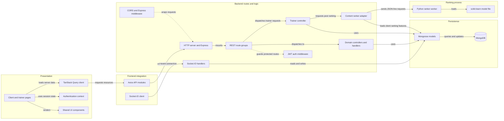

# Architecture Diagram

This diagram describes the current FitConnect implementation, including its browser UI, Node.js API, MongoDB data store, real-time messaging, and optional content-ranking process. The Python ranker is a local child process of the backend, not a separately deployed network service.

## Application Architecture

```mermaid
flowchart TD
    subgraph ClientLayer["Client Layer"]
        Browser["Web browser"]
        ReactApp["React single page application"]
        AxiosClient["Axios API modules"]
        SocketClient["Socket.IO client"]
    end
    subgraph BackendLayer["Backend Layer - Node.js"]
        HttpServer["Node.js HTTP server"]
        ExpressApi["Express REST API"]
        RouteGroups["API route groups"]
        AuthMiddleware["JWT authentication middleware"]
        Controllers["Controllers and route handlers"]
        SocketServer["Socket.IO server"]
        RankBridge["Content ranker adapter"]
    end
    subgraph DataLayer["Data Layer"]
        MongooseModels["Mongoose data models"]
        Mongo[("MongoDB")]
    end
    subgraph RankingLayer["Content Ranking"]
        PythonWorker["Python ranking worker"]
        RankModel["scikit-learn model artifact"]
    end

    Browser -->|"loads frontend bundle"| ReactApp
    ReactApp -->|"uses"| AxiosClient
    ReactApp -->|"uses"| SocketClient
    AxiosClient -->|"HTTP JSON requests"| ExpressApi
    SocketClient -->|"real-time events"| SocketServer
    HttpServer -->|"hosts"| ExpressApi
    HttpServer -->|"attaches"| SocketServer
    ExpressApi -->|"dispatches"| RouteGroups
    RouteGroups -.->|"protects selected endpoints"| AuthMiddleware
    RouteGroups -->|"invokes"| Controllers
    Controllers -->|"reads and writes"| MongooseModels
    SocketServer -->|"persists messages"| MongooseModels
    MongooseModels -->|"CRUD operations"| Mongo
    Controllers -->|"requests feed ranking"| RankBridge
    RankBridge -->|"reads client features"| MongooseModels
    RankBridge -->|"JSON lines over process pipes"| PythonWorker
    PythonWorker -->|"loads scores from"| RankModel
```

<!-- mermaid-checked: no \n, no em-dash/en-dash, no {} in labels, subgraphs are id["label"], arrows are -->|"label"|, all subgraphs closed by end, ids unique -->

### Technology Stack Summary

| Layer | Technology | Version | Purpose |
|---|---|---|---|
| Frontend | React, TypeScript | React `^18.3.1`; TypeScript `^5.8.3` | Builds the client and trainer pages, forms, dashboards, and application state. |
| Frontend build | Vite, SWC React plugin | Vite `^5.4.19`; plugin `^3.11.0` | Runs the development server and bundles the frontend. |
| Frontend routing and data | React Router, TanStack Query, Axios | Router `^6.30.1`; Query `^5.83.0`; Axios `^1.13.2` | Handles client-side routes, server-state access, and HTTP API calls. |
| Frontend UI | Tailwind CSS, Radix UI, shadcn-style components | Tailwind `^3.4.17`; Radix versions in `frontend/package.json` | Provides styling primitives, accessible controls, and reusable UI. |
| Backend | Node.js, Express | Node.js version not pinned; Express `^5.1.0` | Hosts REST endpoints and application request handling. |
| Backend data access | Mongoose, MongoDB Node.js driver | Mongoose `^8.19.2`; driver `^6.20.0` | Defines document models and connects the API to MongoDB. |
| Authentication | JSON Web Token, bcryptjs | JWT `^9.0.3`; bcryptjs `^3.0.2` | Issues and verifies bearer tokens and hashes passwords. |
| Real-time communication | Socket.IO, socket.io-client | Server `^4.8.1`; client `^4.8.3` | Sends message, typing, and read-status events in real time. |
| Ranking | Python, scikit-learn, pandas, NumPy, joblib | Python version not pinned; package minimums in `ml/content-ranker/requirements.txt` | Scores trainer posts using client and post features; stores the trained model artifact. |
| Testing and quality | Jest, Supertest, ESLint | Jest `^30.3.0`; Supertest `^7.2.2` | Supports backend tests, HTTP-level tests, and linting. |

### Data Storage & External Services

MongoDB is the persistent datastore for user and trainer profiles, trainer posts, exercises, workout schedules, messages, notifications, connection requests, and client progress. Mongoose models provide the backend's database access. No external API, cache, or message broker is identified in the inspected implementation. For ranked trainer feeds, the backend starts a local Python worker and exchanges JSON lines over standard input and output; the worker reads a local joblib model file. Ranking is optional: if the model or worker is unavailable, the application returns the unranked feed.

### Key Architectural Decisions

- The application is split into a React single-page frontend and a separately run Express API; the API exposes resource-oriented routes for the major application features.
- JWT bearer authentication is applied to selected routes. Realtime messaging uses Socket.IO and persists message data through the backend's MongoDB models.
- Content ranking is isolated behind a Node.js adapter that runs a Python process and caches ranked results; ranking can be skipped without preventing the main API from serving a feed.

## Component Relationships

<!-- mermaid-checked: no \n, no em-dash/en-dash, no {} in labels, subgraphs are id["label"], arrows are -->|"label"|, all subgraphs closed by end, ids unique -->

### Component Inventory

| Component | Layer | Type | Responsibility |
|---|---|---|---|
| Client and trainer pages | Presentation | React pages | Implements login and signup, dashboards, profiles, progress, trainer browsing, schedules, exercises, messages, and notifications. |
| Shared UI components | Presentation | React components | Provides reusable controls, layouts, navigation, and dashboard UI. |
| Authentication context | Presentation | React context | Shares authentication state with frontend routes and pages. |
| TanStack Query client | Presentation | Server-state client | Coordinates frontend data fetching and caching. |
| Axios API modules | Frontend integration | HTTP client | Calls backend endpoints; the Axios setup adds the stored bearer token to requests. |
| Socket.IO client | Frontend integration | Realtime client | Connects the frontend to backend realtime messaging events. |
| HTTP server and Express | Backend | Server and web framework | Hosts the API, mounts route groups, and attaches Socket.IO to the HTTP server. |
| CORS and Express middleware | Backend infrastructure | Middleware | Configures cross-origin access, request body parsing, logging, and error handling. |
| REST route groups | Backend | Routers and inline handlers | Groups authentication, trainer, schedule, exercise, connection, message, notification, and progress endpoints. |
| JWT auth middleware | Backend infrastructure | Authentication middleware | Verifies bearer tokens and resolves the matching client or trainer account for protected routes. |
| Domain controllers and handlers | Backend | Controllers and route handlers | Implements authentication, messaging, scheduling, progress, and notification behavior; some route files also implement handlers directly. |
| Trainer controller | Backend | Controller | Manages trainer profiles and posts, and composes client-specific trainer feeds. |
| Socket.IO handlers | Backend | Realtime event handlers | Handles user presence, message delivery and persistence, typing indicators, and read status. |
| Mongoose models | Data access | Document models | Represents users, trainers, schedules, exercises, messages, notifications, connection requests, and progress records. |
| MongoDB | Data storage | Document database | Persists application records accessed through Mongoose. |
| Content ranker adapter | Backend integration | Process adapter | Builds ranking features, starts and communicates with the Python worker, and caches ranked feeds. |
| Python ranker worker | Machine learning | Scoring process | Scores trainer posts for a client using the trained model and supplied features. |
| scikit-learn model file | Machine learning | Model artifact | Stores the trained Logistic Regression pipeline loaded by the ranking worker. |

### Implementation Notes

- The backend server connects to MongoDB using `MONGODB_URI`; the separate `config/db.js` helper refers to `MONGO_URI` and is not used by the server's startup path.
- The frontend's Socket.IO helper currently connects to `http://localhost:5000` directly, while REST requests use `VITE_API_URL`. This means the realtime endpoint needs deployment-specific configuration when the frontend is hosted remotely.
- The model training code currently uses scikit-learn `LogisticRegression`; it does not use XGBoost.
